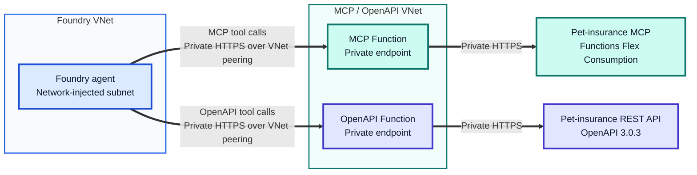
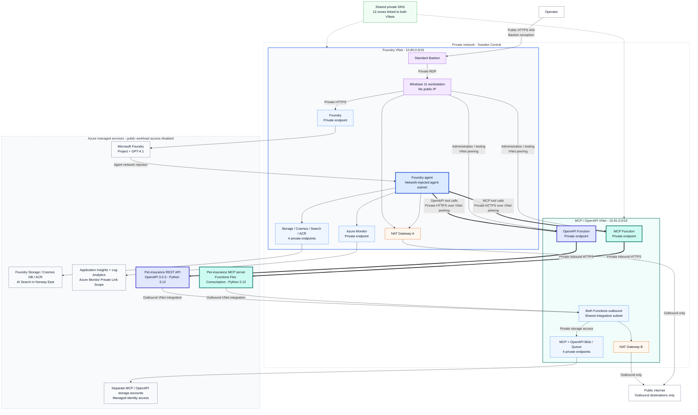

# Microsoft Foundry Agent Service - Remote MCP

A reproducible development environment based on Microsoft Foundry **sample 15**:
two peered virtual networks, private service endpoints, shared DNS, NAT egress,
a Windows 11 workstation behind Azure Bastion, and separate Python MCP and
OpenAPI services on Azure Functions Flex Consumption.

## Deploy to Azure

[](https://portal.azure.com/#create/Microsoft.Template/uri/https%3A%2F%2Fraw.githubusercontent.com%2Fgeorgeollis%2Ffoundry-agent-service-remote-mcp%2Fmain%2Fazuredeploy.json)

Deploy the infrastructure from Azure Portal, without running Bicep locally:

1. Check the [permissions, providers, quota, and licensing prerequisites](docs/deployment.md#prerequisites).
2. Click the button, choose your subscription, and enter a new environment name,
   your Entra **user object ID**, and a strong VM administrator password. Keep the
   regional/model defaults unless you intend to change them.
3. Review the billable resources and select **Review + create**. After deployment
   succeeds, copy its subscription deployment name and run the
   [single completion command](docs/deployment.md#azure-portal-button).

**The button provisions infrastructure, not the Function application packages.**
The completion command publishes both services from the private VM and verifies them.
No public Function access is enabled. For scripted provisioning instead, use
the [PowerShell quick start](#quick-start).

## Architecture

The Foundry agent calls private pet-insurance services using either MCP or an
OpenAPI tool across the peered VNets. Both Functions disable public workload access.



<details>
<summary>Full architecture: private endpoints, administration, DNS, and NAT egress</summary>



**Private tool paths:** Foundry agent -> VNet peering -> the tool's Function
private endpoint -> MCP server or REST API. The bold arrows highlight these tool calls; the
workstation has a separate administration and testing path.

The VNets are peered in both directions. Dashed arrows represent DNS links;
orange nodes are outbound-only NAT gateways, one per VNet. Managed services sit
outside the VNet boundaries: their **twelve private endpoints** reside inside.

</details>

| Component | Configuration |
|---|---|
| Regions | Sweden Central; Search only in Norway East |
| Foundry | Standard agent setup, GPT-4.1, Entra authentication |
| Access | Standard Bastion and Windows 11 Pro 24H2, Trusted Launch |
| MCP | Python 3.12, Flex Consumption, four simulated insurance tools |
| OpenAPI | Separate Flex Function, OpenAPI 3.0.3, three simulated REST operations |
| Networking | Two VNets, two NAT gateways, twelve private endpoints |
| Name resolution | Thirteen private DNS zones, each linked to both VNets |
| Monitoring | Private Azure Monitor ingestion and query |
| Authentication | Managed identities and resource-scoped RBAC |

See [networking and access](docs/architecture.md) for subnet, DNS, and identity
details, and [deployment and operations](docs/deployment.md) for the full runbook.
For the API contract and Foundry import steps, see
[using the OpenAPI tool](docs/deployment.md#openapi-tool-in-foundry).

## Quick start

Requires **PowerShell 7.2+ on Windows**, Azure CLI with Bicep, permission to create
resources and role assignments, eligible Windows 11 licensing, and sufficient
quota. Review the [provider and quota prerequisites](docs/deployment.md#prerequisites)
first.

```powershell
git clone https://github.com/georgeollis/foundry-agent-service-remote-mcp.git
Set-Location .\foundry-agent-service-remote-mcp

$subscription = '<subscription-id>'
$environment = '<environment-name>'
$deployment = @{
    SubscriptionId = $subscription
    EnvironmentName = $environment
}
$outputs = ".azure\$subscription\$environment\deployment-outputs.json"

az account set --subscription $subscription
.\scripts\Deploy.ps1 @deployment -Action Validate
# Review .azure\<subscription-id>\<environment-name>\what-if.json.
.\scripts\Deploy.ps1 @deployment -Action Deploy
.\scripts\Publish-Functions.ps1 -SubscriptionId $subscription -OutputsPath $outputs
.\scripts\Test-Deployment.ps1 -SubscriptionId $subscription -OutputsPath $outputs
```

Validation writes a local receipt bound to the subscription, tenant, environment,
deployment name, source files, and effective parameters. Deployment rejects a
missing or mismatched receipt. No Copilot-specific files are needed.

When adopting an existing portal-created MCP connection, add
`McpConnectionName = '<existing-connection-name>'` to `$deployment` **before both
validation and deployment**. New environments default to `pet-insurance-mcp`.

## Repository layout

```text
infra\
  main.bicep                  Subscription-scoped entrypoint
  main.bicepparam             Region and environment configuration
  modules\                   Network, access, Function, roles, tool connections
  foundry\                   Trimmed, adapted upstream sample 15 modules
  sources.json               Pinned upstream source revisions
azuredeploy.json             Generated, self-contained portal deployment template
scripts\
  Build-PortalTemplate.ps1    Regenerate the portal template from Bicep
  Complete-PortalDeployment.ps1  Import portal outputs, publish Functions, verify
  Deploy.ps1                 Validate/what-if, provision, save outputs
  Publish-Functions.ps1      Publish both services privately and export OpenAPI
  Publish-Mcp.ps1            Compatibility command for MCP-only publishing
  Test-Deployment.ps1        Live networking, DNS, RBAC, MCP, and REST checks
  Test-Deploy.ps1            Offline validation-gate regression checks
src\pet-insurance\           Upstream sample MCP application
src\pet-insurance-api\       REST Function and sample openapi.json
tests\                      OpenAPI contract and HTTP handler tests
docs\                       Architecture and deployment runbook
```

The Bicep entrypoint groups DNS zones by workload rather than relying on numeric
array slices. Unused additional-project templates are removed; the upstream
module layout, source revision, and license are retained.

## Boundaries and costs

- **Bastion HTTPS is public by design.** There is no public RDP, and workload,
  storage, and monitoring access is private.
- Function outbound traffic uses VNet integration and NAT. This also allows its
  host/deployment storage to remain private; outbound was not left unintegrated.
- The MCP connection uses `RemoteTool`, anonymous authentication, custom MCP
  metadata, and disabled sharing. The endpoint is anonymous **inside the private
  network**, not a production authorization boundary.
- The REST API also uses anonymous HTTP authentication inside the private network.
  Bicep provisions its anonymous OpenAPI project connection with sharing disabled.
  Its OpenAPI spec contains no keys. Add authentication before using real data.
- Pet-insurance tools return simulated data. This is a development/POC sample,
  not a production insurance service.
- Bastion, NAT, Search, Cosmos DB, registry, private endpoints, storage, disks,
  the VM, and model usage incur charges. Stopping the VM does not stop the other
  charges.

All deployment state, credentials, logs, and concrete environment identifiers
stay in ignored local files under `.azure\`. The published `azuredeploy.json`
is compiled from Bicep without environment parameters or credentials.
Documentation uses placeholders instead of deployed resource names.

## Attribution

Based on Microsoft's [Foundry sample 15](https://github.com/microsoft-foundry/foundry-samples/tree/main/infrastructure/infrastructure-setup-bicep/15-private-network-standard-agent-setup)
and Azure Samples' [pet-insurance MCP server](https://github.com/Azure-Samples/AI-Gateway/tree/main/labs/ai-foundry-toolbox/mcp-servers/pet-insurance).
See [NOTICE](NOTICE) and the preserved licenses. This repository is MIT licensed.
